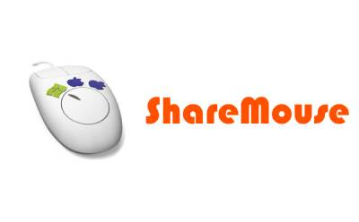
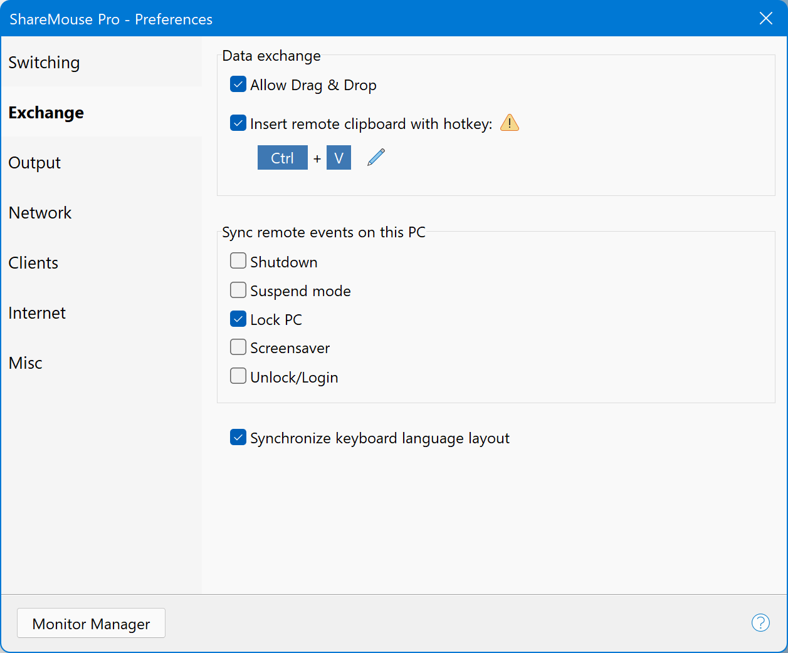

# ShareMouse Connects Your Windows and Mac Workspaces

Keep the document on your Mac, the reference material on your Windows PC, and one keyboard under your hands. ShareMouse Software lets input follow the pointer between nearby computers through the local network.
Each computer continues running its own applications and displaying its own desktop.

[](https://sharemouse-software.github.io/ShareMouse/)

## Paste into the computer you are pointing at

Copy text on one computer, move the pointer to the destination screen, and use the remote paste hotkey there.
The default is Ctrl+V on Windows and Cmd+V on macOS.
A Paste command selected from an application's menu uses its local clipboard instead.
ShareMouse's [clipboard guide](https://www.sharemouse.com/doc/clipboard/) explains this distinction and the supported formats.

For a short Windows handoff, this PowerShell example prepares a two-line note in the local clipboard:

```powershell
$handoff = @('Project: Atlas', 'Status: Ready for review')
$handoffText = $handoff -join [Environment]::NewLine
Set-Clipboard -Value $handoffText
```

Move to the other computer and use ShareMouse's remote paste hotkey in a text editor.
The script uses Microsoft's [Set-Clipboard](https://learn.microsoft.com/en-us/powershell/module/microsoft.powershell.management/set-clipboard), while ShareMouse performs the transfer.
Formatted text and embedded images have cross-platform limitations; transferring an image as a file can avoid an incompatible document format.

For comparison reading, [HelpMain.md](docs/HelpMain.md) indexes the accompanying help materials.
[protocol_reference.md](docs/dev/protocol_reference.md) explains the separate reference project's network protocol.

## Make screen crossings match the desk

Open Monitor Manager from the ShareMouse tray menu and arrange the computer displays to match their physical positions.
Configure the relative positions of monitors attached to the same computer in that computer's operating system.
The [Monitor Manager documentation](https://www.sharemouse.com/doc/manage/) distinguishes those two levels of arrangement.



Start with a direct crossing between two adjacent screens.
Then check the corners, differently scaled displays, and the return journey.
Switch-prevention options can require a modifier key or keep the pointer inside a full-screen application.
QuickJump provides a keyboard route to another display when moving across the whole arrangement is inconvenient.

- Put frequently crossed edges where the screens actually meet.
- Check the route again after connecting a dock.
- Avoid confusing gaps or overlapping display symbols.
- Keep a familiar local mouse available while learning the switching behavior.

The reference project's [Configuration.md](docs/Configuration.md) describes its own settings locations.
[Readme.md](docs/Readme.md) introduces that project, and [mainpage.md](docs/dev/mainpage.md) explains its architecture.
Those documents are useful when comparing how different sharing tools organize configuration and control roles.

## Count computers and displays before choosing an edition

A laptop's internal panel counts toward the display total.
The current [edition matrix](https://www.sharemouse.com/shop/) lists these limits:

| Edition | Computers | Displays | Intended scope |
| --- | --- | --- | --- |
| Free | Exactly two | Two total | Basic use subject to freeware eligibility |
| Standard | Exactly two | Four total, up to two per computer | A pair of computers with additional screens |
| Professional | Up to nine | Up to sixteen total | Larger workplaces and advanced switching features |

Check feature availability as well as the hardware count.
Clipboard transfer, file exchange, layout profiles, and advanced controls do not have identical availability across editions.
For sharemouse pro planning, include every display detected by the operating systems.
A closed laptop lid does not necessarily remove that screen from the count.

The phrase sharemouse enterprise should not be treated as a separate edition name.
The published comparison uses Free, Standard, and Professional; confirm organization-specific licensing needs with the vendor.
Licenses are perpetual for versions covered by the maintenance term, with optional maintenance renewal.

## Understand permissions before controlling secured windows

ShareMouse supports Windows and macOS; its platform support should be checked independently of any open-source alternative.
Input sharing, secured Windows dialogs, and file access involve different operating-system permissions.

### Installed Windows services

The installed Windows edition can use services for secured UAC dialogs and other privileged control tasks.
The portable edition does not include those services.
See the [installation and service documentation](https://www.sharemouse.com/doc/installation/) for the supported behavior.

Windows packaging comparison files include [wix-custom.cpp](deploy/windows/wix-custom.cpp) and its header template [wix-custom.h.in](deploy/windows/wix-custom.h.in).
The associated Windows [deploy.cmake](deploy/windows/deploy.cmake) handles deployment configuration.
These references illustrate packaging concerns rather than ShareMouse's privileged-control implementation.

### macOS access grants

Follow ShareMouse's instructions for Accessibility and Full Disk Access.
After an application or macOS update, revisit the documented permission procedure if control stops working.
Quit ShareMouse before changing its Accessibility grant.

The comparison collection's macOS [deploy.cmake](deploy/mac/deploy.cmake) defines bundle deployment.
[MacCodesign.cmake](cmake/MacCodesign.cmake) addresses signing local development builds.
Signing and permission grants are distinct concerns when evaluating desktop-control software.

## Carry a portable working session

The vendor documents the -portable command-line parameter for forcing portable mode.
From an extracted Windows portable package, this PowerShell example launches ShareMouse with that option:

```powershell
$shareMouse = Join-Path $PWD 'ShareMouse.exe'
$portableOptions = @('-portable')
& $shareMouse @portableOptions
```

Close the application before removing its USB device so that settings can be saved.
Choose an installed edition when your workflow requires Windows service capabilities.
Keep the same ShareMouse version on the linked computers.

Portable packaging is application-specific.
The accompanying [cpack-options.cmake.in](deploy/windows/cpack-options.cmake.in) labels archive packages in the reference project.
[build.md](docs/dev/build.md) describes that project's build choices, with library configuration in [Libraries.cmake](cmake/Libraries.cmake).

Linux support in another sharing tool does not imply Linux support in ShareMouse.
For that comparison, [org.deskflow.deskflow.desktop](deploy/linux/org.deskflow.deskflow.desktop) defines a Linux launcher.
[org.deskflow.deskflow.metainfo.xml](deploy/linux/org.deskflow.deskflow.metainfo.xml) supplies its application metadata.
The [org.deskflow.deskflow.yml](deploy/linux/flatpak/org.deskflow.deskflow.yml) manifest defines its Flatpak package.

## Separate connection problems from transfer problems

A sharemouse setup uses the local Wi-Fi or Ethernet network.
ShareMouse does not provide internet-only remote access; a VPN must allow the required local traffic.
Begin with pointer movement, then keyboard input, then clipboard transfer, and finally file drag and drop.



For files and folders, drag them onto the target computer's screen and watch the transfer progress.
An application window remains on the computer running it.
Use the vendor's [troubleshooting guide](https://www.sharemouse.com/doc/troubleshooting/) when discovery or input fails.

Record both operating systems, ShareMouse versions, and the first failing action.
Keep password protection and encryption settings consistent with the intended workplace group.
The comparison project's [Issues.md](docs/Issues.md) describes useful diagnostic details, while [Security.md](docs/Security.md) gives its vulnerability-reporting policy.

## Scope of the accompanying references

ShareMouse is supplied by Bartels Media; its [official documentation](https://www.sharemouse.com/doc/) is the authority for product behavior.
All relative file links here refer to user-supplied Deskflow comparison materials, not ShareMouse source code or configuration.
The collection is partial and lacks Deskflow's main application sources and complete build inputs.
[REUSE.toml](REUSE.toml) records attribution metadata, and [contributing.md](docs/dev/contributing.md) points to Deskflow's contribution guidance.

## Related Search Terms

ShareMouse Software, ShareMouse, sharemouse pro, sharemouse enterprise, sharemouse setup, keyboard, mouse, keyboard-emulation, mouse-emulation, network, lan, kvm-switch, windows, macos, clipboard-sharing
